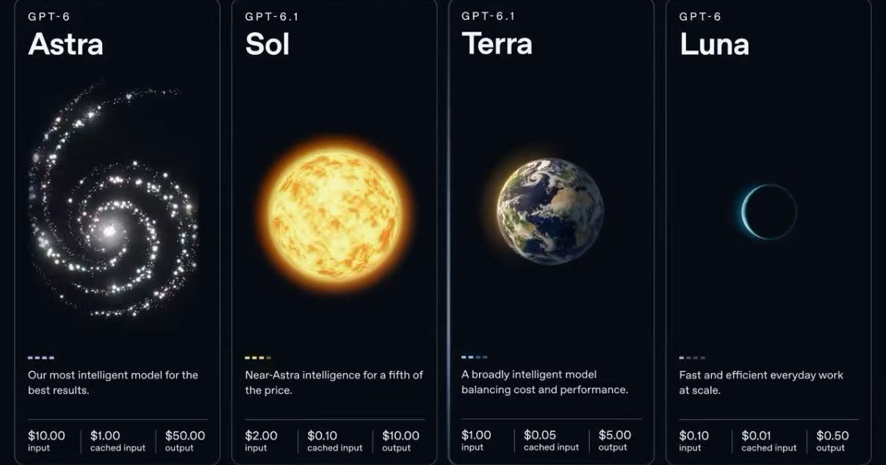
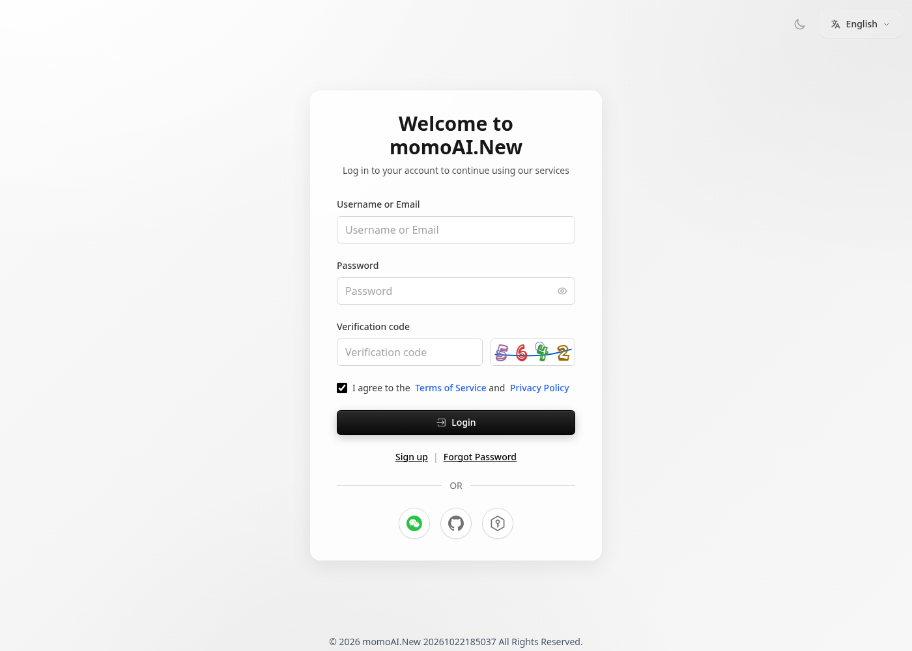

> 在线阅读（GitHub Pages）：https://maynor996.github.io/gpt6v-yingyong/

# GPT6.v应用场景有哪些？如何落地

> 关键词：`gpt6.v应用` · 更新：2026-10 · Maynor996

你搜「gpt6.v应用」，多半是想尽快搞清楚哪里能**安全地体验或调用**相关模型。请把「官网」理解为产品入口说明，而不是某个必须存在的中文仿域名。正式名称以 OpenAI 当日公开文档与产品列表为准；本文是社区向中文说明，**不是**仿冒「GPT6.cn」官网。

## 命名说明

社区检索常出现 GPT-6、GPT-6.0、GPT-6.v、GPT-6.1（Terra / Sol / Luna / Astra）等写法。**正式名称以 OpenAI 当日公开文档与产品列表为准**。

## 应用方向

- **写作**：提纲、润色、多风格改写、纪要压缩
- **编程**：读报错、写样例、小范围重构
- **API**：客服助手、内容流水线、内部问答（注意合规）

## 为什么国内常走网页 / API / 包月

支付不便、网络延迟、官方配额门槛，是常见原因。第三方路径便于验证，但**不等于** OpenAI 官方，请先小额试用。

## 软推荐入口（无 aff 参数）

1. 网页体验：[https://trygpt.asia/](https://trygpt.asia/)
2. 全模型 API：[https://tryallapi.com/](https://tryallapi.com/)
3. 包月套餐：[https://momoai.asia/](https://momoai.asia/)

店铺参考（非硬推销）：[https://wzyp.cn/shop/maynorai](https://wzyp.cn/shop/maynorai)

## 短步骤

1. 打开上述任一站点并登录
2. 在模型列表选择与检索词最接近的当日条目
3. 先网页验证，再按需接 API / 包月
4. 用真实任务试一轮，记录质量与费用后再加预算

## 使用建议（补充）

先用一个真实小任务验证：例如润色一段邮件、解释一段报错、或跑一次最小 chat.completions。确认模型名称、延迟与计费单位后，再把预算和提高频次。若站点模型列表暂时没有你想要的精确名称，选择最接近的同系列条目，并关注后续更新，而不是去安装来路不明的「加速器客户端」。把本页与同系列「官网入口 / 下载 / 介绍 / 应用」说明对照阅读，可以减少被仿站话术带偏的概率。

## 常见问题 FAQ

### 有没有正宗「gpt6.v应用」中文域名？

请勿轻信「唯一官网」。以 OpenAI 公开渠道与你信任的服务商为准。

### 国内怎么进？需要下载吗？

能直连官方更好；否则用可信网页或兼容 API。一般**不需要**安装破解客户端。

### 和 GPT-5 有什么区别？

用同一批提示词对比质量、速度与价格，不要只看标题。

### 本页链接是官方吗？

不是。TryGPT / TryAllAPI / MomoAI 为第三方路径，链接无联盟参数。

## 相关阅读

- [gpt6.v下载](https://maynor996.github.io/gpt6v-xiazai/)
- [gpt6.0应用](https://maynor996.github.io/gpt6-0-yingyong/)
- [gpt6 astra官网](https://maynor996.github.io/gpt6-astra-guanwang/)

## 免责声明

第三方服务 ≠ OpenAI 官方；价格与上架以当日页面为准；请自行评估安全与合规风险。本页不承认任何「GPT6.cn」仿官网声称。
